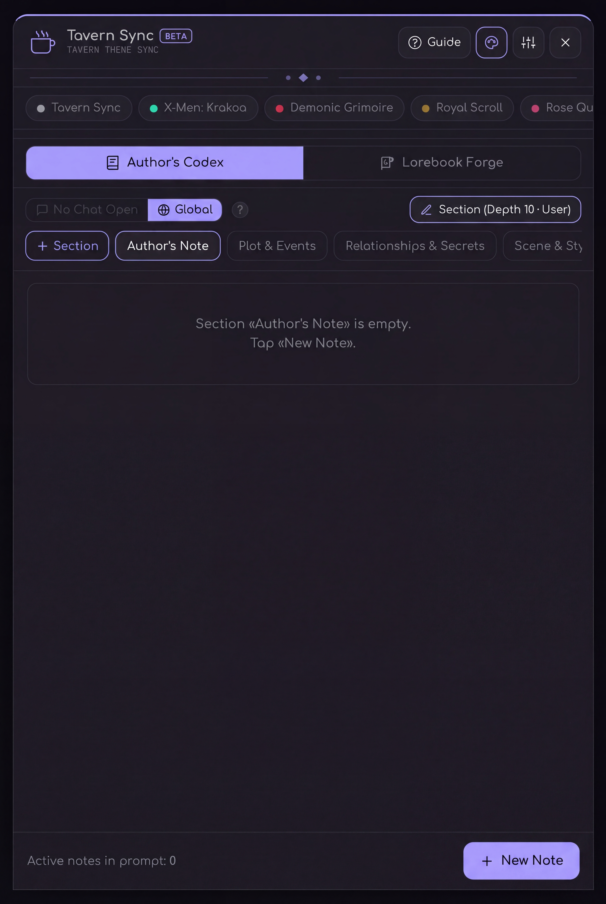
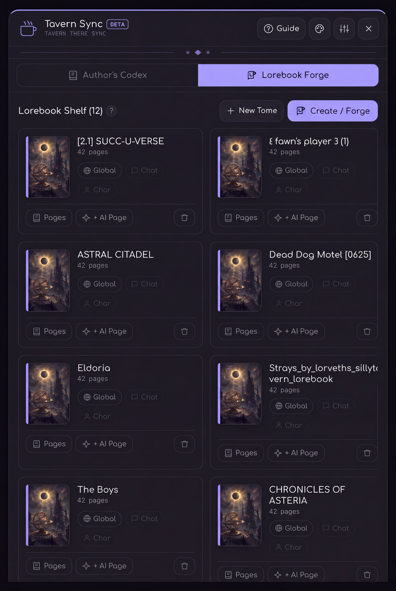

<div align="center">


# Pocket Codex & Forge `[BETA v1.0.3]`

**A dual-wing Author's Notebook & Lorebook Forge for SillyTavern — crafted for both Desktop and Mobile screens.**

[**English Documentation**](README.md) · [**Русская документация (RU)**](README.ru.md)

</div>

---

## Overview

**Pocket Codex & Forge** combines two essential roleplay and worldbuilding tools inside a single, responsive modal window with **13 handcrafted vector SVG themes** and full **English / Russian** localization:

1. **Author's Codex (`Codex Wing`)** — a multi-tab, card-based notebook with per-section prompt routing (`@ Depth`, `Before/After Main Prompt`, `{{notebook}}` macro, or local storage), flexible heading styles, automatic paragraph spacing, drag-and-drop sorting, and an integrated **AI Co-Author** with 8 presets.
2. **Lorebook Forge (`Forge Wing`)** — a visual Lorebook shelf and editor that supports **binding multiple Lorebooks to the same chat simultaneously**, collapsing entries with key counters, inspecting trigger recursion chains, and forging single pages or entire Lorebooks with AI using a privacy-safe structural skeleton matcher.

---

## Desktop & UI Showcase

### 1. Author's Codex (`Midnight Velvet` Theme · Desktop View)



### 2. Lorebook Forge & Multi-Book Shelf (`X-Men: Krakoa` Theme · Desktop View)



---

## Key Features

### Author's Codex
- **Dual Scopes (`This Chat` & `Global`):** Keep chat-specific plot trackers separate from universal rules or cross-chat lore, or merge them automatically.
- **Per-Section Prompt Routing:** Each tab has its own injection position (`In-Chat @ Depth`, `Before Prompt`, `After Prompt`, `{{notebook}}` macro, or `Nowhere`), role (`System`, `User`, `Assistant`), and frequency interval.
- **Clean Formatting & Auto-Spacing:** 4 section header modes and 4 note subheader styles (`####`, `[Brackets]`, `Bold:`, or plain text) with guaranteed `\n\n` paragraph separation and a live formatting preview.
- **Built-in AI Co-Author:** 8 specialized presets to draft, expand, or refine notes using any SillyTavern Connection Profile.

### Lorebook Forge
- **Multi-Lorebook Chat Binding:** Bind **multiple Lorebooks to a single chat at the same time** alongside `Global` and `Character` bindings — no longer limited to SillyTavern's default single chat Lorebook slot.
- **Blind Structural Skeleton Matching:** When generating new Lorebook entries with AI, the Forge never leaks or reads text from your existing Lorebooks; it only measures structural formatting metrics (average paragraph count, length, and subheader style) to keep formatting consistent.
- **Collapsible Entries & Recursion Inspector:** Collapse individual or all pages inside a book with key-count badges, and trace how primary and secondary triggers chain into other entries.

### 13 Vector SVG Themes
Every theme includes a custom vector crest, ornamental banner, and tailored color palette (zero emojis in UI):
`Tavern Default` · `X-Men: Krakoa` · `Demonic Grimoire` · `Medieval Scroll` · `Rose Quartz` · `Manga Editorial` · `Classic Notebook` · `Astral Codex` · `Cyber Neurolink` · `Midnight Velvet` · `Emerald Herbarium` · `Marble & Gold` · `Oceanic Abyss`

---

## One-Click Installation in SillyTavern

1. Open **SillyTavern** and go to the **Extensions** panel (top bar).
2. Click **Install Extension**.
3. Paste the repository URL:
   ```text
   https://github.com/Gerodot535/st-pocket-codex
   ```
4. Click **Install for all users** (or current user) and reload SillyTavern.
5. Click the **Book icon** on the left side of the chat input bar to open **Pocket Codex & Forge** (switch between `English (EN)` and `Русский (RU)` anytime via the top-right **Settings / Sliders** button).

---

## Compatibility

- Tested on **SillyTavern 1.19.0 (`staging` & `release`)** across Desktop browsers and Android mobile browsers.
- **100% compatible with `SillyTavern-MemoryBooks`:** uses isolated settings/metadata namespaces (`st_pocket_codex` / `pcx_extra_world_info`) and preserves all custom entry fields when editing Lorebooks.

---

## Author & License

Created by [**Gerodot535**](https://github.com/Gerodot535).
