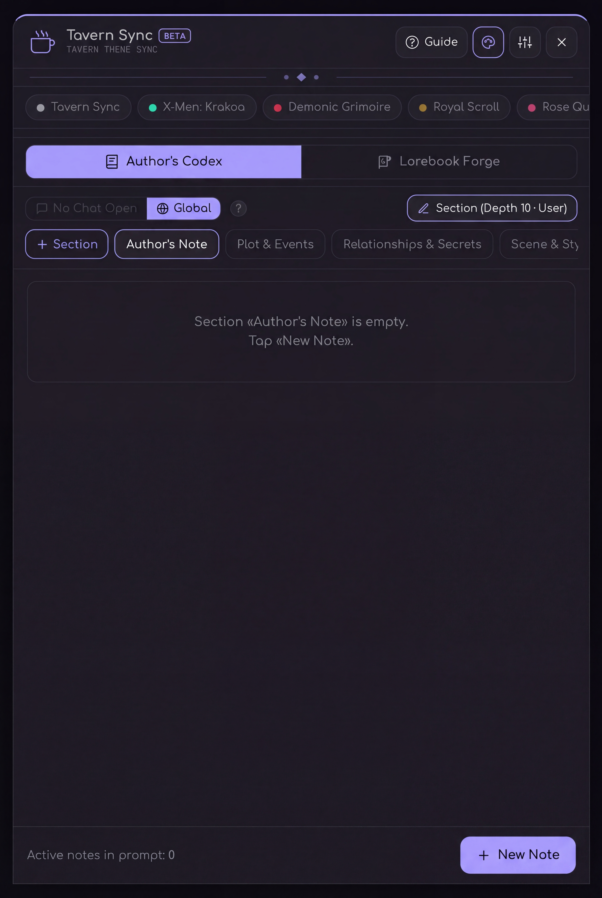
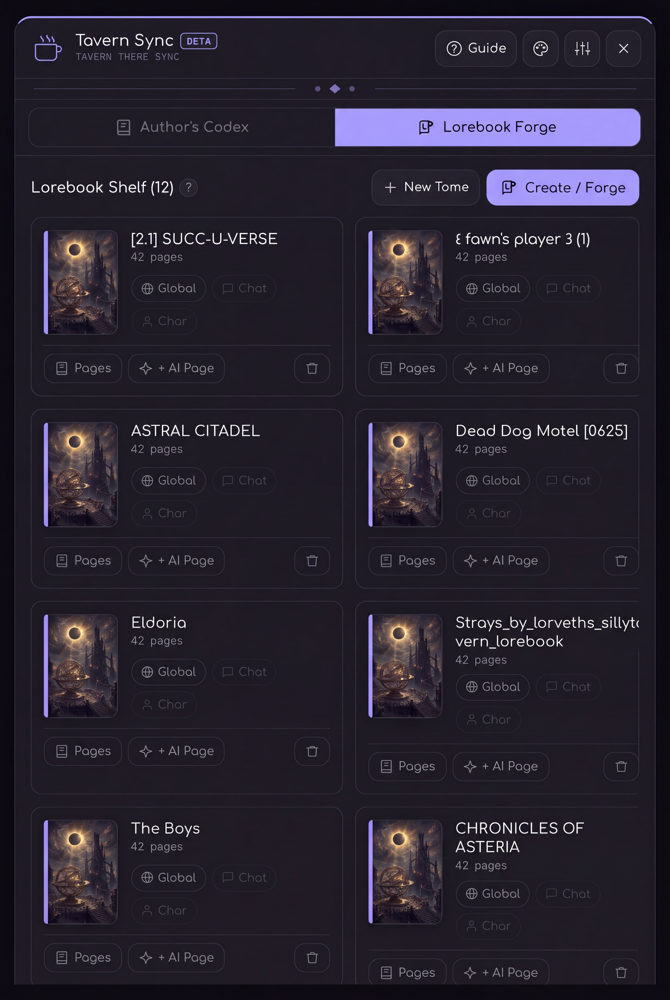

<div align="center">


# Pocket Codex & Forge `[BETA v1.0.4]`

**Двухкрылый Кодекс Автора и Кузница Лорбуков для SillyTavern — созданный для комфортной работы и на телефонах, и на ПК.**

[**English Documentation (EN)**](README.md) · [**Русская документация**](README.ru.md)

</div>

---

## О расширении

**Pocket Codex & Forge** объединяет два главных авторских инструмента ролевика в одном адаптивном окне с **13 векторными SVG-темами** и полной поддержкой **русского и английского языков**:

1. **Кодекс Автора (`Кодекс Автора`)** — многовкладочный блокнот с карточками заметок, индивидуальной отправкой каждого раздела в промпт (`На глубину @ Depth`, `До/После промпта`, в макрос `{{notebook}}` или `Никуда`), гибкими заголовками, авто-отступами абзацев, перетаскиванием и встроенным **ИИ-Соавтором** (8 пресетов).
2. **Кузница Лорбуков (`Кузница Лорбуков`)** — наглядная полка и редактор всех Лорбуков Таверны с возможностью **подключать сразу несколько Лорбуков в один чат одновременно**, сворачивать записи со счётчиком ключей, проверять цепочки рекурсии и ковать с помощью ИИ как отдельные страницы, так и целые книги со слепой сверкой формата.

---

## Витрина интерфейса

### 1. Кодекс Автора (Тема `Midnight Velvet / Полуночный Бархат` · Вид на ПК)



### 2. Кузница Лорбуков и полка мульти-привязки (Тема `X-Men: Krakoa` · Вид на ПК)



---

## Главные возможности

### Кодекс Автора
- **Две области (`Этот чат` и `Общие`):** держите сюжетные заметки конкретного чата отдельно от сквозных правил или объединяйте их одним тумблером.
- **Гибкая маршрутизация каждого раздела:** у каждой вкладки своя глубина (`@ Depth`), роль (`System`, `User`, `Assistant`) и шаг отправки.
- **Чистые заголовки и отступы без склейки:** 4 режима заголовков раздела и 4 стиля подзаголовков карточек (`####`, `[Скобки]`, `Жирный:`, без оглавлений) с гарантированным разделением `\n\n` и живым превью.
- **Встроенный ИИ-Соавтор:** 8 готовых пресетов для генерации и доработки записей через любой профиль подключения SillyTavern.

### Кузница Лорбуков
- **Мульти-привязка Лорбуков в чат:** подключайте **сразу несколько Лорбуков к одному чату одновременно** (помимо тумблеров `Глобально` и `Персонаж`), снимая стандартное ограничение Таверны на один лорбук чата.
- **Слепая сверка структурного скелета:** при генерации новых страниц ИИ никогда не читает чужие знания из установленных книг — замеряется только средний скелет разметки (число абзацев, длина и вид подзаголовков).
- **Сворачивание страниц и Инспектор рекурсии:** сворачивайте записи по одной или кнопкой «Свернуть все» (с отображением счётчика ключей) и проверяйте, какие страницы будят друг друга по цепочке.

### 13 авторских SVG-тем
У каждой темы свой векторный герб, узорный баннер и палитра (строго без эмодзи в коде и интерфейсе):
`Тема Таверны` · `Люди Икс: Кракоа` · `Демонический Гримуар` · `Средневековый Свиток` · `Розовый Кварц` · `Манга-редакция` · `Классический Блокнот` · `Астральный Кодекс` · `Кибер-Нейролинк` · `Полуночный Бархат` · `Изумрудный Гербарий` · `Мрамор и Золото` · `Океаническая Бездна`

---

## Установка в SillyTavern в один клик

1. Откройте **SillyTavern** и перейдите во вкладку **Расширения (Extensions)**.
2. Нажмите **Установить расширение (Install Extension)**.
3. Вставьте ссылку на репозиторий:
   ```text
   https://github.com/Gerodot535/st-pocket-codex
   ```
4. Нажмите кнопку установки и обновите страницу Таверны.
5. Нажмите на **иконку книги** слева от поля ввода сообщения, чтобы открыть **Pocket Codex & Forge** (язык интерфейса `Русский / English` переключается в любой момент через иконку настроек в правом верхнем углу окна).

---

## Совместимость

- Проверено на **SillyTavern 1.19.0 (`staging` и `release`)** на компьютерах и смартфонах Android.
- **Полная совместимость с `SillyTavern-MemoryBooks`:** расширение использует изолированные ключи хранения (`st_pocket_codex` / `pcx_extra_world_info`) и бережно сохраняет все служебные метки `Memory Books` при редактировании записей.

---

## Автор

Автор проекта: [**Gerodot535**](https://github.com/Gerodot535).
